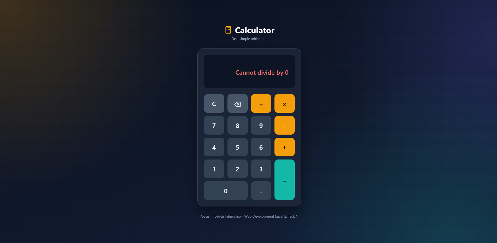
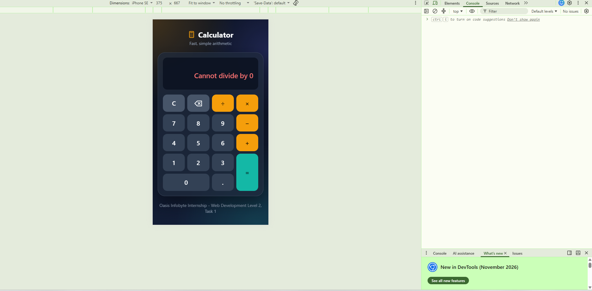

# Browser Calculator

A browser-based calculator built for the Oasis Infobyte Internship, Web
Development Level 2, Task 1. It is written with plain HTML, CSS and
JavaScript and uses its own tokenizer and evaluator instead of any built-in
string evaluation.

## Features

- Two-line display: a small expression line and a large input or result line
- Digits 0 to 9 and a decimal point
- Addition, subtraction, multiplication and division
- Correct operator precedence, so 5 + 3 × 2 gives 11
- Equals, Clear (C) and Backspace buttons
- Result can be used as the start of the next calculation
- Friendly error message for division by zero
- Keyboard support
- Responsive layout for mobile widths

## How to Run

ES modules do not load from `file://`, so open `index.html` through a local
server, for example the VS Code Live Server extension:

1. Open the `WebDev-L2-Calculator` folder in VS Code.
2. Right-click `index.html` and choose Open with Live Server.

Keyboard shortcuts: digits, `+ - * /`, `Enter` or `=` for equals,
`Backspace` to delete, `Escape` to clear and `.` for the decimal point.

## Project Structure

```
WebDev-L2-Calculator/
  index.html          Page markup
  css/
    style.css         Styles and color variables
  js/
    calculator.js     Pure logic: state, tokenizer, evaluator, formatting
    main.js           DOM references, event listeners and rendering
  screenshots/
    .gitkeep          Keeps the folder in version control
  README.md
```

## How It Works

The calculator keeps the expression as a plain string such as `5+3*2`.
Every button press produces a new state object from the old one, and
`main.js` renders that state to the page.

### Tokenizing

Tokenizing splits the expression string into an array of numbers and
operators. The string `5+3*2` becomes `['5', '+', '3', '*', '2']`. The
tokenizer reads one character at a time. Digits and decimal points are
collected into a number, and when an operator appears the collected number
and the operator are both added to the array. A minus sign at the very start
has no number before it, so it stays part of the first number, which makes
`-5` a single negative number.

### Two-pass evaluation

Evaluation walks over the token array twice:

1. First pass: every `×` and `÷` is resolved from left to right. The two
   numbers around the operator are replaced by their result.
2. Second pass: the remaining `+` and `−` are resolved from left to right.

For `5 + 3 × 2` the first pass turns `5 + 3 × 2` into `5 + 6`, and the second
pass turns it into `11`. Doing multiplication and division first is what
gives them higher precedence.

### Rounding

Results are rounded to 10 decimal places and trailing zeros are removed, so
`0.1 + 0.2` shows `0.3` instead of `0.30000000000000004`.

## Edge Cases Handled

- Only one decimal point per number
- Pressing an operator twice in a row replaces the previous operator
- The expression cannot start with `×` or `÷`, but a leading minus is allowed
- Floating point noise is removed from results
- Numbers are limited to 15 digits, and long values scroll inside the
  display instead of overflowing
- Results that are too large show an error message
- Equals on an incomplete expression such as `5 +` does nothing
- Division by zero shows `Cannot divide by 0`; press C, Backspace or type a
  new number to recover
- Leading zeros are not stacked, so `007` becomes `7`

## Known Limitations

- Numbers that combine about 15 integer digits with decimals can show small
  binary floating point artifacts, because JavaScript uses 64-bit floats
  (example: `999999999999999 + 0.9`).

## Tech Used

- HTML5
- CSS3 with CSS Grid and custom properties
- Vanilla JavaScript with ES modules
- No frameworks, libraries or CDN links

## Screenshots






#oasisinfobyte

